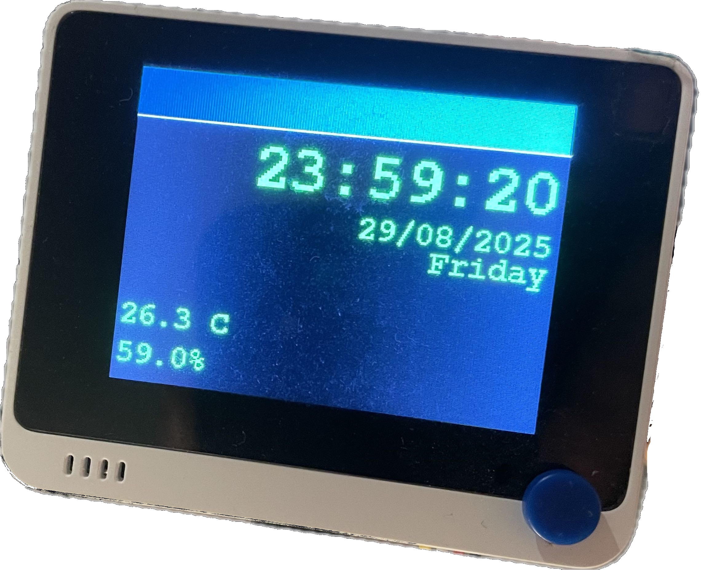

# Klåckwörk
Is it a clock? Is it a thermometer? A humidity reader? Compiling and uploading this to your [Wio Terminal](https://wiki.seeedstudio.com/Wio_Terminal_Intro/) will give you all of the above! A real nice-to-have if you have a USB-hub with a charging port on your desk.

<p align="center">
  
</p>

## How to set up
* Follow the steps [here](https://wiki.seeedstudio.com/Wio-Terminal-Getting-Started/#software), where you will download Arduino IDE, and add the Wio board library.
* Clone the repo, and open up the `src/main` folder in the IDE.
* Download the libraries using the Library Manager, along with their dependencies if prompted to:
  * [NTPClient](https://github.com/arduino-libraries/NTPClient)
  * [Grove Temperature And Humidity Sensor](https://github.com/Seeed-Studio/Grove_Temperature_And_Humidity_Sensor) _(The hardware is optional, but the library is necessary.)_
  * [Seeed Arduino RTC](https://github.com/Seeed-Studio/Seeed_Arduino_RTC)
  * [Seeed Arduino rpcWiFi](https://github.com/Seeed-Studio/Seeed_Arduino_rpcWiFi) _(version >= 1.1.0)_
  * [Timezone](https://github.com/JChristensen/Timezone)
  * Time ([link?](https://playground.arduino.cc/Code/Time/))
* Create a file named `config.h` in `src/main`:
```cpp
#ifndef config_h
#define config_h

#include <Arduino.h>
#include <Timezone.h>
#include <stdint.h>

class config {
  public:
    // wifiCredentials index correspons to one WiFi network.
    // numberOfNetworks should be manually changed, depending on how many networks are used.
    static constexpr uint8_t numberOfNetworks = 2;
    static constexpr const char* wifiCredentials[numberOfNetworks][2] = {
      {"SSID1", "PASS1"},
      {"SSID2", "PASS2"}
    };

    // Refer to Timezone documentation for setting up the timezone. Default is Sweden.
    static constexpr TimeChangeRule standardTime = {"CET", Last, Sun, Oct, 3, 60};   // Standard Time (Default: Sweden)
    static constexpr TimeChangeRule summerTime = {"CEST", Last, Sun, Mar, 3, 120};   // Summer Time (Default: Sweden)
};

#endif
```
* I'm writing this at 3 AM and I'm sure I've forgotten something. Let me know.

# Legacy README
## Ideas
- Almanac
  - Categorized roughly as small, normal or big events, which changes how far ahead in the future they are shown.
- Daily/Monthly/Yearly Reminders
- Holy shit, a virtual keyboard?
- Primitive PC application that is used for defining events and reminders, as well as changing some settings. Start with a console program. 

## Requirements (Wio)

### Functional Requirements
- R1: The system shall always display the time.
- R2: The system shall display drastic changes in weather conditions.
- R3: Time sensitive information shall be showed as the system's default state. <!-- I actually don't believe in requirements. SRS requirements seem sillily unspecific and unspecific at the same time. Maybe I'm forgetting something. -->
- R4: The system shall provide a customizable and scheduled timer.
- R5: The system shall provide an alarmclock.
- R6: The system shall display the ambient temperature and humitidy.
- R7: The system shall warn the user of high CO2 levels.
- R8: The system shall remind the user of regularly occuring chores.
- R9: The system shall warn the user when it's battery is running out.
- R10: The state of the Wio's environment shall be monitorable via a smartphone app. (Possibly Blynk on iOS)


### Non-Functional Requirements
- NFR1: User input should not take longer than 30 ms to register.

### Constraints:
- C1: All internet communication must be encrypted and secure.

### Assumptions
- Millis will reset after ~50 days
- The system is powered by battery, and needs to be recharged.
- The system will spontaneously combust and cause a fire that will claim people's lives and cause major property damage.
- The system will exist in a world, with a lot of things, with a lot of API's. A lot of fun can be had, and wacky things can be achieved.  
